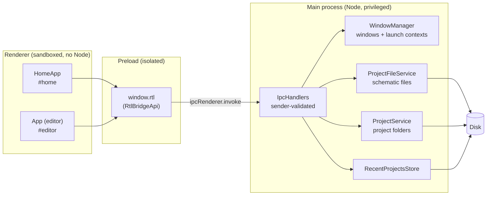
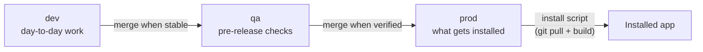

# Architecture

How MachineMaker is put together: the tech stack, how the processes divide the work, where data lives, and how code moves from a commit to an installed app.

## Tech stack

| Layer | Technology | Why |
|---|---|---|
| Desktop shell | [Electron](https://www.electronjs.org) 45 | One codebase for Windows, macOS and Linux, with real file-system access. |
| Language | TypeScript 5 (strict) | One language across main, preload and renderer, with shared types for the IPC contract. |
| UI | React 18 | Component model for the editor and home page. |
| Canvas | [React Flow](https://reactflow.dev) (`@xyflow/react`) 12 | Pan/zoom, node dragging and edge rendering; MachineMaker supplies custom nodes (blocks, gate symbols) and edges (routed wires). |
| State | [Zustand](https://zustand-demo.pmnd.rs) 5 | Small stores readable from outside React (keyboard shortcuts, tab switching, autosave). |
| Build | [electron-vite](https://electron-vite.org) 6 on Vite 8 | Bundles the three Electron targets with one config and gives hot reload in development. |
| Packaging | [electron-builder](https://www.electron.build) 26 | Produces the unpacked app the install scripts copy into place. |
| Tests | [Playwright](https://playwright.dev) driving Electron | End-to-end tests against the real app; see [TESTING_STRATEGY.md](TESTING_STRATEGY.md). |
| Other runtime deps | `yaml` (schematic-as-code import/export), `nanoid` (ids), `html-to-image` (PNG export) | |

## Process model

Electron splits the app into a privileged **main** process and sandboxed **renderer** processes, one per window. They talk only through a narrow, typed bridge.



- **Main** (`src/main/`) owns windows, native dialogs and every file read and write. Each concern is its own class, all wired together in `index.ts`.
- **Preload** (`src/preload/`) exposes exactly the methods in `RtlBridgeApi` on `window.rtl`, through `contextBridge`. It has no logic.
- **Renderer** (`src/renderer/`) is one Vite bundle with two roots. `main.tsx` mounts `HomeApp` when the window's URL hash is `#home`, and the editor `App` otherwise. Each window asks the main process for its **launch context** (`getLaunchContext`) to learn which project or schematics to show.
- **Shared** (`src/shared/`) holds the on-disk data model (`diagram-model.ts`, `project-model.ts`) and the IPC contract (`ipc-contract.ts`), imported by both sides so the two ends of each channel can't drift apart.

Security boundaries (sandbox, IPC sender validation, navigation lockdown) are described in [SECURITY.md](SECURITY.md).

## Windows and navigation

The app has two kinds of window:

1. **Home window** (at most one): the landing page (recent projects, New/Open Project) and the project page (schematic list and stats).
2. **Editor windows** (any number): the canvas, each with up to 8 document tabs in its title bar.

Opening a schematic from the home page calls `openEditor`, which opens a new editor window *alongside* the home window. The house button (`returnHome`) brings the home window forward on that editor's project, reopening it if it was closed. Closing an editor's last tab closes that window.

**One window per document.** Two windows autosaving the same file would silently overwrite each other's work. Each editor window therefore reports its open paths to the main process (`OpenDocumentRegistry`), and every open request checks it first. A schematic already open anywhere brings that window and tab forward instead of opening a second copy.

**Dragging tabs between windows.** `TabBar.tsx` drives tab drags with pointer capture rather than HTML drag-and-drop. Chromium keeps reporting a captured pointer while the button is held, even outside the window, so the release point is known on any monitor. Along the strip, a drag reorders. Once the pointer leaves the strip, the tab "tears off", and on release the renderer flushes the document to disk and hands its full state (diagram, undo/redo stacks, viewport) to the main process (`detachTab`). The main process then decides:

| Released over | Result |
|---|---|
| Another editor window's tab strip (with room) | The tab moves into that window at the drop position (`TabAttach` push). |
| Anywhere else, from a window with several tabs | A new editor window opens there with the tab (launch context `transfer`). |
| Anywhere else, from a window with one tab | The source window itself moves to the drop point (as in Chrome). |

"Topmost" for overlapping windows is approximated by focus order, since Electron doesn't expose z-order.

## Editor state

- **`diagram-store.ts`** holds the **one live document**: the diagram, its file path, selection, undo/redo stacks and view toggles. Every canvas edit goes through `commit()`. That pushes an undo snapshot, then re-applies the layout invariants: fixed port positions, minimum block sizes, and gate symmetry (`port-layout.ts`).
- **`tab-store.ts`** layers tabs on top. Inactive tabs park a snapshot of their document (diagram, path, history, selection and viewport). Switching tabs flushes autosave, parks the outgoing document, and swaps the incoming one into the diagram store. The rest of the editor therefore only ever deals with "the current document".
- **`use-autosave.ts`** writes the live document about 800 ms after an edit settles.
- **`model/`** is pure, framework-free logic: geometry, wire routing (A* over a grid), layout rules, SVG export, schematic-as-code parsing, and stats. That makes it the natural target for unit tests.

## Data on disk

| What | Where | Format |
|---|---|---|
| Project | any folder the user picks | `rtl-project.json` manifest + `schematics/` + `state-machines/` |
| Schematic | `<project>/schematics/<Name>.rtlproj` | JSON (`RtlDiagram`, `schemaVersion`ed) |
| Loose schematic (no project) | `Documents/MachineMaker/` (`MachineMaker Dev/` in development) | `.rtlproj` |
| Recent projects | `<userData>/recent-projects.json` | JSON list |
| Theme and other preferences | `<userData>` (Chromium localStorage) | — |

A schematic belongs to a project by living in its folder, not by being listed in the manifest. A file copied in by hand, or restored from git, just shows up.

### Development vs. production data

`src/main/app-channel.ts` runs first thing at startup and gives each channel its own data roots:

| | Installed (packaged) | From source (`npm run dev`, tests) |
|---|---|---|
| `userData` | `<appData>/MachineMaker` | `<appData>/MachineMaker Dev` |
| Loose autosaves | `Documents/MachineMaker` | `Documents/MachineMaker Dev` |

Both paths are set explicitly. Electron's default would derive one folder from `package.json`'s name for *both* builds, and on case-insensitive filesystems that's a single shared folder. The test suite goes further, giving each test a throwaway folder through `MACHINEMAKER_USER_DATA`.

## Branches, CI and delivery



| Branch | Purpose | CI on push |
|---|---|---|
| `dev` | Day-to-day development (the old `master`). | typecheck, build, `npm audit`, end-to-end tests, CodeQL |
| `qa` | Release candidates, promoted from `dev`. | all of the above + packaging on Windows, macOS and Linux |
| `prod` | The released app. The install scripts build from here. | all of the above + packaging on Windows, macOS and Linux |

`qa` and `prod` started as empty branches. The first promotion into each is a merge of unrelated histories, and every later one is an ordinary merge:

```bash
git switch qa   && git merge --allow-unrelated-histories dev   # first time only
git switch prod && git merge --allow-unrelated-histories qa    # first time only
```

Workflows (`.github/workflows/`):

| Workflow | Trigger | Does |
|---|---|---|
| `ci.yml` | push / PR to dev, qa, prod | verify → end-to-end tests (Linux, xvfb); package matrix on qa/prod |
| `codeql.yml` | push / PR + weekly | CodeQL `security-extended` scan, results in the Security tab |
| `sbom.yml` | weekly + dependency changes | CycloneDX SBOM → OSV-Scanner → fails on any known-malicious package |

Install and update are deliberately simple: `scripts/install.ps1` and `scripts/install.sh` clone (or fast-forward) `prod`, run `npm ci`, build, package with `electron-builder --dir`, and copy the result into a per-user location. Running the same command again updates. See [INSTALL.md](INSTALL.md).

## Repository layout

```
src/
  main/        Electron main process: windows, IPC, files, projects, data paths
  preload/     contextBridge API (window.rtl)
  renderer/
    index.html
    public/    Static assets (app icon)
    src/
      components/        React UI; home/ holds the home page
      model/             Pure logic: geometry, routing, layout, export, stats
      state/             Zustand stores and hooks (diagram, tabs, autosave, shortcuts)
      styles/            tokens.css (theme), app.css, tabs.css, home.css
  shared/      Data model + IPC contract shared by main and renderer
tst/           Playwright end-to-end suite (see tst/README.md)
scripts/       install.ps1 / install.sh: build-from-source install and update
security/      CodeQL config and results, review report, SBOM checker
docs/          This documentation
.github/       CI, CodeQL and SBOM workflows
```
